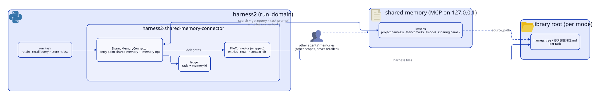

# harness2-shared-memory-connector

[English](README.md) | 日本語

## 概要

[Harness²](https://github.com/reeschan/harness2) のメモリのコネクターです。ハーネス一式のライブラリは、今までどおりファイルに置きます。教訓（cue・lesson・evidence）だけを [shared-memory](https://github.com/reeschan/shared-memory) のサーバーで共有します。recall は、依頼文に関係する教訓を shared-memory に問い合わせて選びます。

<picture>
  <source media="(prefers-color-scheme: dark)" srcset="assets/architecture/architecture-dark.svg">
  
</picture>

図のソースは `assets/architecture/architecture.d2` です。arch-diagram スキルの `render.py` で描き直します。

## 前提

- POSIX。Windows では WSL を使います。
- Python 3.12〜3.13。
- harness2。依存として入り、テストを通したコミットに固定されています。
- shared-memory のサーバー。MCP のサーバーで、既定の URL は `http://127.0.0.1:7820/mcp` です。harness2 を動かす PC で動いている必要があります。サーバーの中身は shared-memory のリポジトリを参照してください。

## インストール

```bash
pip install "harness2-shared-memory-connector @ git+https://github.com/reeschan/harness2-shared-memory-connector.git"
```

## 使い方

`HARNESS2_MEMORY_CONNECTOR=shared-memory` でこのコネクターを選びます。`HARNESS2_MEMORY_SCOPE` に共有名を渡します。共有名が、ライブラリと記憶の置き場所を決めます。

```bash
export HARNESS2_MEMORY_CONNECTOR=shared-memory
export HARNESS2_MEMORY_SCOPE=team-alpha
export HARNESS2_MEMORY_RECALL=1
harness2 --bench jb --substrate oc --k 1 --split all \
  --memory-opt url=http://127.0.0.1:7820/mcp \
  --memory-opt write=1
```

- `HARNESS2_MEMORY_RECALL=1` を付けると、harness2 が各タスクに recall を注入します。harness2 の recall は既定ではオフです。
- 共有名が無いときは、このコネクターはファイルのコネクターとまったく同じ動きになります。shared-memory には一切触れません。
- 共有名は、ライブラリの root の形（`<runs_root>/library/<ベンチマーク>/scope-<共有名>/<モード>`）と一致している必要があります。一致しないときは、warning を 1 行出して shared-memory を使いません。

## オプション

値はすべて `--memory-opt` で文字列として渡します。

| オプション | 既定 | 意味 |
| --- | --- | --- |
| `url` | `http://127.0.0.1:7820/mcp` | shared-memory のサーバーの MCP の URL。 |
| `write` | `0` | `0` は読むだけ。`1` は教訓を shared-memory にも書く。書いた記憶は人が Git にコミットする。 |
| `limit` | `5` | recall で読む記憶の数。 |
| `timeout` | `30.0` | MCP のタイムアウト（秒）。 |

`write` はオンの値として `true` と `yes`、オフの値として `false` と `no` も受け付けます。`limit` は 1 以上でなければなりません。`timeout` は秒の数値でなければなりません。

## 書くものと引くもの

**書くもの。** 共有名が設定されていて `write` がオンのときだけ、記憶を書きます。記憶は次の項目を持ちます。

- Memory scope: `project:harness2.<ベンチマーク>.<モード>.<共有名>`。`A-Za-z0-9._-` の外の文字は `-` になります。
- タイトル: `<domain>: <task_id>`。200 文字までです。
- 本文: cue・lesson・evidence を `- **cue**: ...` の行で並べ、ハーネスに理由があれば `## Why` を続けます。
- kind: `semantic`。
- provenance: `agent_inferred`。
- source_agent: `harness2`。
- タグ: `harness2`、`domain:<domain>`、`task:<slug>`。`<slug>` はそのタスクのライブラリのエントリ名です。
- source_path: そのタスクのライブラリのエントリのディレクトリ。

**引くもの。** harness2 は依頼文を検索のクエリとして渡します。先頭の 2,000 文字を使い、依頼文が空のときはドメイン名を使います。

- この memory scope だけを、kind `semantic` と `domain:<domain>` のタグで検索します。ほかのエージェントの記憶は別の memory scope にあるので、混ざりません。
- 今のタスク自身の記憶は除きます。このストリームでまだ来ていないタスクの記憶、つまり最後の `retain` で見えなくなったエントリの記憶も除きます。
- `limit` 件までの記憶を読み、`## <タイトル>` のブロックとして並べ、recall の長さで切ります。

**同じタスクを書き直したとき。** コネクターは、タスクごとに書いた記憶の id を台帳（ledger）に残します。台帳はライブラリの root の下の `shared-memory-ledger.json` です。書き直しのときは、前の id を `supersedes` として渡します。shared-memory がその id を拒否したら、`supersedes` なしで書き直します。台帳は PC ごとにあります。別の PC で同じタスクを書いた分は 2 件目の記憶になり、置き換わりません。

## shared-memory が使えないとき

コネクターは warning を 1 行出し、ファイルだけで続けます。

- recall はファイルの recall に切り替わります。
- 書き込みはファイルへの保存までで止まります。タスクは失敗しません。

shared-memory が書き込みを拒否したときも、同じように終わります。

## 開発

WSL で実行します。

```bash
uv run --python 3.12 python -m unittest discover -s tests
uvx ruff@0.17.1 check .
uvx ruff@0.17.1 format --check .
```

## ライセンス

Apache-2.0。[LICENSE](LICENSE) を参照してください。
